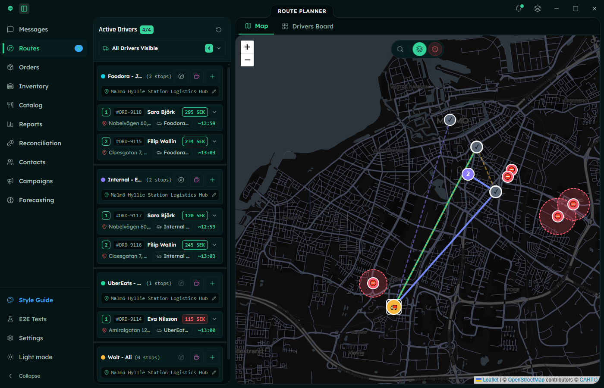
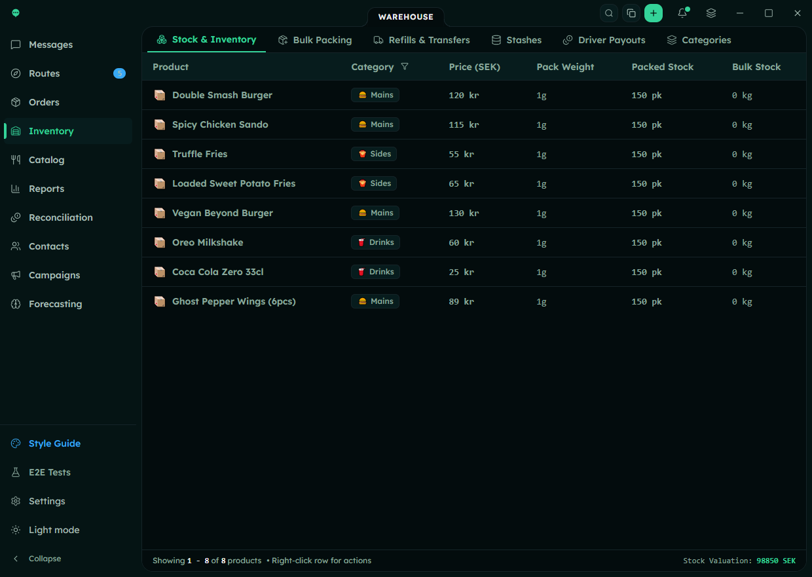
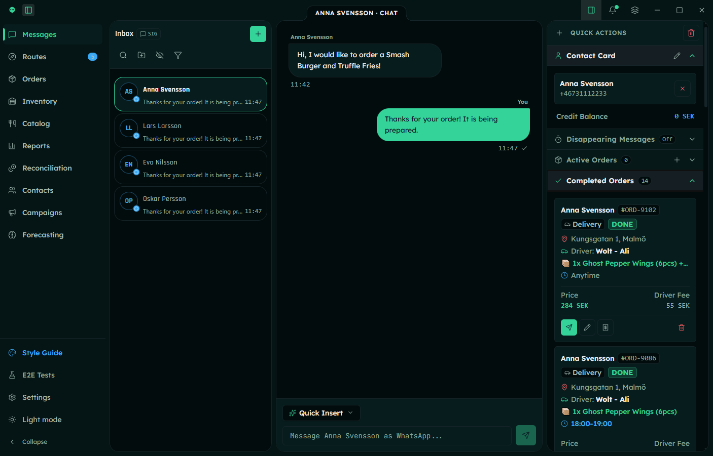
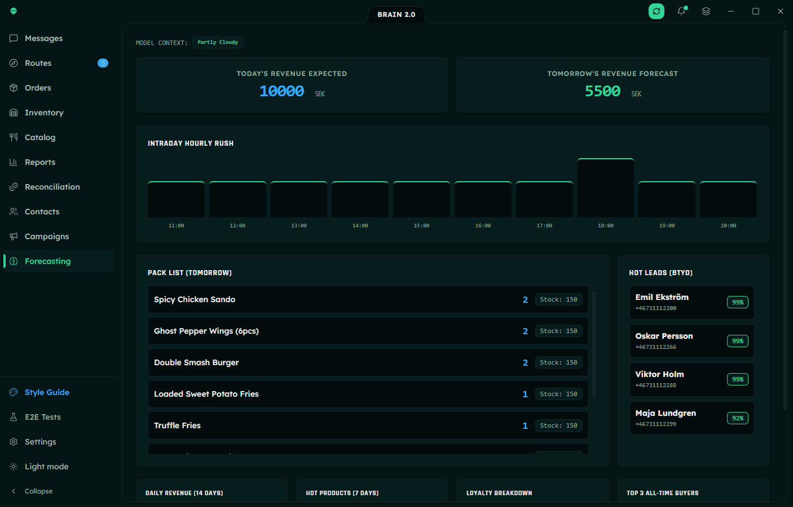
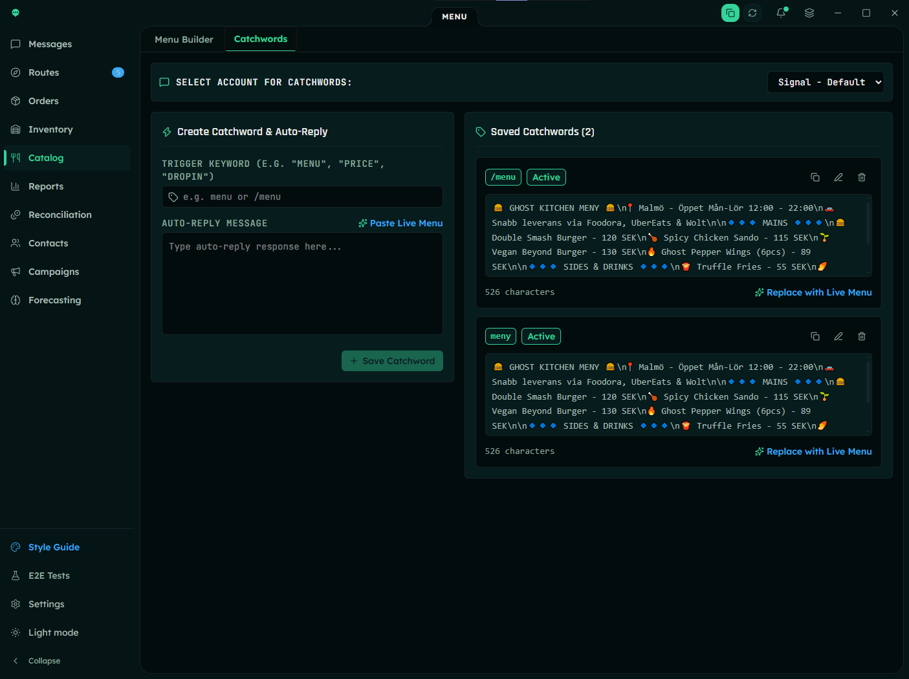
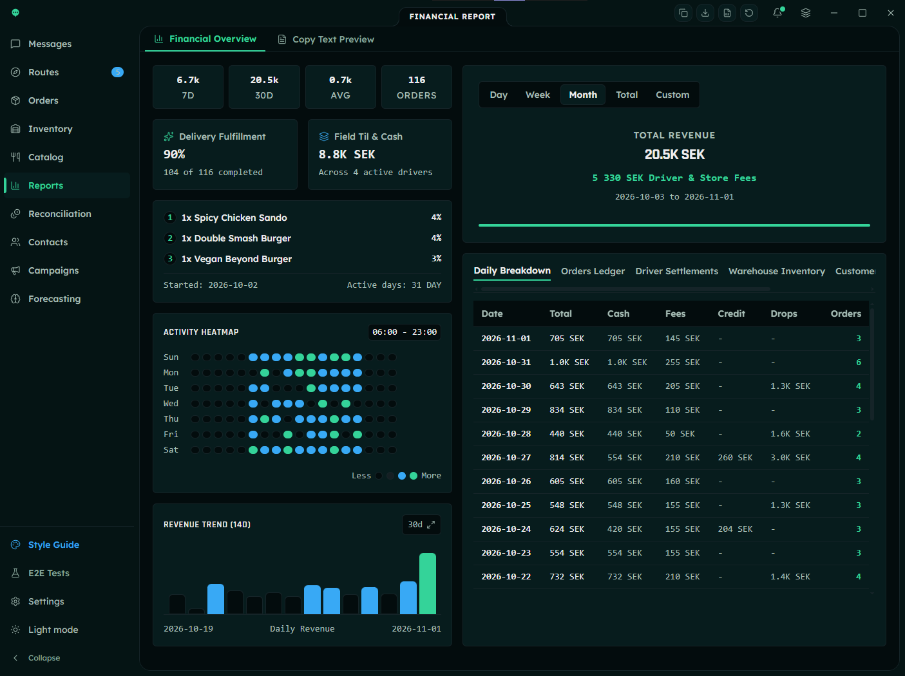

<link rel="preconnect" href="https://fonts.googleapis.com"/>
<link rel="preconnect" href="https://fonts.gstatic.com" crossorigin=""/>
<link href="https://fonts.googleapis.com/css2?family=JetBrains+Mono:wght@400;500;600;700&family=Rajdhani:wght@400;500;600;700&display=swap" rel="stylesheet"/>
<link href="https://fonts.googleapis.com/css2?family=Material+Symbols+Outlined:wght,FILL@100..700,0..1&display=swap" rel="stylesheet"/>

  <!-- Operational Air-Gap Banner Strip -->
  <aside aria-label="System status" class="w-full bg-surface-container-lowest border border-border rounded-lg py-2 px-4 md:px-6 flex flex-wrap items-center justify-between text-label-sm font-label-sm gap-2">
    

      
      LOCAL AIR-GAP READY / ZERO CLOUD DEPENDENCY
    

    

      SQLCipher AES-256 WAL: <strong class="text-success font-normal">ENCRYPTED</strong>
      |
      DAEMON: <strong class="text-text-primary font-normal">BACKGROUND TRAY ACTIVE</strong>
    

  </aside>

  <!-- In-Page Sticky Tactical Navigation Bar -->
  

    

      <!-- Brand Logo / Product Name -->
      

        

          
        

        

          0perator
          DISPATCH ENGINE v3.2 · RELEASE 1.0.1
        

      

      <!-- Desktop Navigation Links -->
      <nav class="hidden lg:flex items-center space-x-6 text-label-md font-label-md">
        <a class="text-secondary-container font-medium border-b-2 border-secondary-container pb-1 transition-all duration-150" href="#core-engine">Operations Core</a>
        <a class="text-text-muted hover:text-text-primary transition-colors py-1" href="#route-planner">Architecture</a>
        <a class="text-text-muted hover:text-text-primary transition-colors py-1" href="#security-specs">Security Specs</a>
        <a class="text-text-muted hover:text-text-primary transition-colors py-1" href="#comparison">Comparison</a>
      </nav>
    

  

  <!-- Hero Section: Tactical Mission Control -->
  <section class="relative pt-4 pb-8 overflow-hidden">
    

      <!-- Hero Header Cluster -->
      

        

          
          BUILT FOR HIGH-TEMPO DISPATCH OPERATIONS • 100% LOCAL-FIRST
        

        <h1 class="text-headline-xl font-headline-xl text-text-primary mb-6 leading-tight text-3xl sm:text-4xl md:text-5xl">
          Local-First Delivery Operations Hub with Zero Telemetry
        </h1>
        

          Engineered for dispatchers, couriers, and warehouse managers who demand absolute privacy, zero cloud subscription fees, and microsecond desktop responsiveness. Encrypted at rest with SQLCipher AES-256.
        

        <!-- CTAs & Platforms -->
        

          <a class="inline-flex items-center gap-2 px-5 py-3.5 bg-surface border border-border text-text-secondary font-headline-sm rounded hover:bg-surface-elevated hover:border-border-strong transition-all active:scale-95" href="#security-specs">
            data_object
            Explore Architecture Docs
          </a>
        

        <!-- Specs Ticker Bar -->
        

          

            bolt
            0ms Cloud Latency
          

          

            shield
            Zero Telemetry
          

          

            key
            SQLCipher AES-256
          

          

            password
            Argon2id Master PIN
          

          

            memory
            Wails v3 + Go Core
          

        

      

      <!-- High-Fidelity Hero Workstation Mockup (Dispatch Console) -->
      

        <!-- Mockup Title Bar -->
        

          

            

              
              
              
            

            

              
              0perator Client Workstation
              /
              Central Hub Stockholm South
            

          

          

            
              
              DAEMON SYNC 100%
            
            PID: 40924
          

        

        <!-- Real Screenshot Display -->
        

          
        

      

    

  </section>

  <!-- Core Capabilities Matrix (6-Grid Bento) -->
  <section class="py-12 border-t border-border bg-surface-container-lowest/60 rounded-2xl p-6" id="core-engine">
    

      

        
Instrument-Grade Control

        <h2 class="text-headline-lg font-headline-lg text-text-primary text-2xl md:text-3xl">Complete Operational Dispatch Subsystems</h2>
      

      

        Purpose-built for zero-friction distribution centers. No cloud sync hangs, no web browser bloat, no subscription locks.
      

    

    

      <!-- Card 1 -->
      <article class="bg-surface p-5 rounded-xl border border-border hover:border-info transition-all duration-200 flex flex-col justify-between overflow-hidden">
        

          

            scale
          

          <h3 class="text-headline-md font-headline-md text-text-primary mb-2">Warehouse &amp; Packing Conversion</h3>
          

            Dual stock tracking bridges the gap between bulk storage and field dispatch. Real-time yield calculators (1 kg → 143 bags) automatically update driver stashes and prevent phantom inventory drift.
          

        

        

          
        

        

          • Auto Yield Reconciliation • Immutable Driver Stashes
        

      </article>
      <!-- Card 2 -->
      <article class="bg-surface p-5 rounded-xl border border-border hover:border-info transition-all duration-200 flex flex-col justify-between overflow-hidden" id="route-planner">
        

          

            alt_route
          

          <h3 class="text-headline-md font-headline-md text-text-primary mb-2">Route Planner &amp; 2-Opt TSP</h3>
          

            Native traveling salesperson problem (TSP) algorithm with 2-Opt heuristic. Features offline Swedish address autocomplete, driver rest break insertions (10/20/30m), and dynamic real-time ETA recalculations.
          

        

        

          
        

        

          • 2-Opt Sub-second Recalculation • Street Index Cache
        

      </article>
      <!-- Card 3 -->
      <article class="bg-surface p-5 rounded-xl border border-border hover:border-info transition-all duration-200 flex flex-col justify-between overflow-hidden">
        

          

            mark_chat_unread
          

          <h3 class="text-headline-md font-headline-md text-text-primary mb-2">Signal &amp; WhatsApp Ticket Inbox</h3>
          

            Unified dispatch messaging console that respects disappearing timers on customer channels while maintaining permanent encrypted dispatcher notes. One-click conversion from direct message to manifest order.
          

        

        

          
        

        

          • Disappearing Timer Sync • 1-Click Manifest Gen
        

      </article>
      <!-- Card 4 -->
      <article class="bg-surface p-5 rounded-xl border border-border hover:border-info transition-all duration-200 flex flex-col justify-between overflow-hidden">
        

          

            psychology
          

          <h3 class="text-headline-md font-headline-md text-text-primary mb-2">Brain 2.0 AI Forecasting</h3>
          

            Embedded local Facebook Prophet time-series engine. Predicts stockout depletion velocity and courier load using a 7-day blended moving average—all evaluated on bare-metal Go without external API calls.
          

        

        

          
        

        

          • Embedded Prophet Model • Zero External API Latency
        

      </article>
      <!-- Card 5 -->
      <article class="bg-surface p-5 rounded-xl border border-border hover:border-info transition-all duration-200 flex flex-col justify-between overflow-hidden">
        

          

            dock
          

          <h3 class="text-headline-md font-headline-md text-text-primary mb-2">System Tray &amp; Background Daemons</h3>
          

            Designed to run silently in the system tray. Closing the window minimizes to tray; background daemons continue batch message transmissions with jitter throttling to prevent carrier IP blacklists.
          

        

        

          
        

        

          • Minimize-to-Tray Daemon • Adaptive Broadcast Jitter
        

      </article>
      <!-- Card 6 -->
      <article class="bg-surface p-5 rounded-xl border border-border hover:border-info transition-all duration-200 flex flex-col justify-between overflow-hidden">
        

          

            payments
          

          <h3 class="text-headline-md font-headline-md text-text-primary mb-2">Cash Drops &amp; Kassa Settlement</h3>
          

            End-of-shift physical cash accounting. Immutable double-entry audit trails verify driver drops, tally item commissions in SEK, and produce encrypted export slips for offline accounting safes.
          

        

        

          
        

        

          • Strict SEK Reconciliation • Audit-Proof Ledger Entries
        

      </article>
    

  </section>

  <!-- Security & Architecture Deep Dive -->
  <section class="py-12 border-t border-border" id="security-specs">
    

      
Application Security Assessment

      <h2 class="text-headline-lg font-headline-lg text-text-primary text-2xl md:text-3xl mb-3">Local Database Security Review</h2>
      

        The operational database uses SQLCipher. OPlane's assessment identified unresolved findings, so this review is not a certification or a guarantee that the application is free of vulnerabilities.
      

    

    

      <!-- Code Architecture Visual Tree -->
      

        

          0perator Core File Hierarchy
          Go 1.22 + Wails v3
        

        

          
0perator-engine/

          
└── app/main.go // Window lifecycle &amp; tray hook

          
└── internal/core/

          
│&nbsp;&nbsp;└── db.go // SQLCipher cipher_version 4.x

          
│&nbsp;&nbsp;└── database_service.go // AES-256 WAL transaction lock

          
│&nbsp;&nbsp;└── tsp_router.go // 2-Opt route optimizer in Go

          
│&nbsp;&nbsp;└── brain_service.go // Prophet time-series algorithm

          
└── internal/messaging/

          
│&nbsp;&nbsp;└── signal_service.go // Signal protocol IPC pipe

          
│&nbsp;&nbsp;└── whatsapp_service.go // Local QR Multi-device daemon

          
└── storage/

          
└── operator.db.enc // AES-256 SQLCipher encrypted payload

        

        

          ZERO NETWORK SOCKETS BIND TO CLOUD
          100% AIR-GAP
        

      

      <!-- Cryptographic Details & Backup Architecture -->
      

        

          <!-- Detail Card 1 -->
          

            

              lock
              <h4 class="font-headline-sm text-headline-sm text-text-primary">Argon2id Master PIN</h4>
            

            

              Passphrase hashing configured with 64 MB memory cost, 4 parallel threads, and 3 iterations. Resists GPU and ASIC brute-force rainbow tables.
            

            

              Memory-Hard KDF Verification
            

          

          <!-- Detail Card 2 -->
          

            

              database
              <h4 class="font-headline-sm text-headline-sm text-text-primary">SQLCipher WAL Mode</h4>
            

            

              Write-Ahead Logging provides microsecond disk transactions without read locks. Zero plaintext leakage to swap space or operating system memory dumps.
            

            

              Page-level HMAC Checksumming
            

          

        

        <!-- Security Review Section -->
        

          

            

              verified_user
              <h4 class="font-headline-sm text-headline-sm text-text-primary">Security Reviewed by OPlane</h4>
            

            <svg class="h-6 w-auto text-text-primary" viewBox="0 0 3334 900" role="img" aria-labelledby="oplane-logo-title" xmlns="http://www.w3.org/2000/svg">
              <title id="oplane-logo-title">OPlane</title>
              <g fill="currentColor" fill-rule="nonzero">
                <path d="M1190.625,670.708c-107.708,0 -183.083,-82.875 -183.083,-204.917c0,-122.042 75.333,-204.917 183.083,-204.917c107.75,0 183.042,82.875 183.042,204.917c0,122.042 -75.333,204.917 -183.042,204.917Zm0,-58c69.292,0 114.5,-57.25 114.5,-146.917c0,-89.667 -45.208,-147.667 -114.5,-147.667c-69.292,0 -114.5,57.25 -114.5,147.667c0,90.417 45.208,146.917 114.5,146.917Z"/>
                <path d="M1489.708,605.167l0,150.417l-67.792,0l0,-487.167l67.792,0l0,57.25c23.375,-38.417 67.042,-64.792 122.042,-64.792c109.25,0 171.75,92.667 171.75,204.917c0,112.25 -62.5,204.917 -171.75,204.917c-55,0 -98.667,-26.375 -122.042,-65.542Zm-1.5,-125.042c0,90.375 55.75,131.083 111.458,131.083c73.833,0 115.25,-61.042 115.25,-145.417c0,-84.375 -41.417,-145.375 -115.25,-145.375c-55.75,0 -111.458,39.917 -111.458,131.833l0,27.875Z"/>
                <rect x="1831.75" y="177.75" width="67.792" height="484.667"/>
                <path d="M1943.958,556.208c0,-78.333 61.042,-110.75 149.167,-128.833l95.667,-19.583l0,-16.583c0,-45.208 -24.875,-70.833 -77.583,-70.833c-49.708,0 -79.125,23.375 -91.167,67.042l-64.042,-16.583c18.833,-64.042 76.833,-110 157.458,-110c88.125,0 142.375,42.958 142.375,127.333l0,192.083c0,25.625 15.833,33.875 42.208,27.875l0,54.25c-60.292,7.542 -94.917,-6.792 -103.208,-44.458c-24.125,30.875 -67.792,51.25 -121.292,51.25c-71.583,0 -129.583,-42.167 -129.583,-113l-0,0.042Zm244.833,-95.667l-76.833,16.583c-60.25,12.042 -100.958,28.625 -100.958,76.083c0,38.417 27.875,61 70.833,61c58,0 106.958,-35.417 106.958,-85.875l0,-67.792Z"/>
                <path d="M2333.417,268.417l67.792,0l0,53.5c22.625,-32.375 61.75,-61.042 117.5,-61.042c83.625,0 131.083,58 131.083,141.625l0,259.875l-67.792,0l0,-241.833c0,-55 -23.375,-96.417 -82.125,-96.417c-49,0 -98.708,37.667 -98.708,103.208l0,235.042l-67.792,0l0,-394l0.042,0.042Z"/>
                <path d="M2693.5,465.792c0,-117.5 74.583,-204.917 181.542,-204.917c106.958,0 168,83.625 168,192.833l0,22.625l-284.75,0c3.75,82.875 51.25,135.583 119.792,135.583c52.75,0 90.417,-28.625 102.458,-75.333l59.5,21.083c-24.125,70.083 -83.625,113 -161.958,113c-109.208,0 -184.583,-83.625 -184.583,-204.917l-0,0.042Zm68.583,-41.417l212.458,0c-1.5,-55.75 -31.625,-105.458 -100.208,-105.458c-57.25,0 -100.208,38.417 -112.25,105.458Z"/>
              </g>
              <g fill="currentColor" fill-rule="nonzero">
                <path d="M387.292,466.583l137.375,94.167c27.458,18.833 63.708,18.833 91.167,0l137.375,-94.167l-136.958,-94.042c-27.708,-19.042 -64.25,-19.042 -91.958,0l-136.958,94.042l-0.042,0Z"/>
                <path d="M570.25,261.833c104.083,0 189.958,77.708 202.958,178.25l62.958,-43.167c18.917,-13 18.958,-40.917 0,-53.917l-219.958,-151c-27.708,-19.042 -64.25,-19.042 -91.958,0l-219.75,150.875c-19,13.042 -19,41.125 0,54.167l62.75,43c13,-100.542 98.875,-178.25 202.958,-178.25l0.042,0.042Z"/>
                <path d="M570.25,671.292c-104,0 -189.875,-77.583 -202.958,-178.042l-62.792,43.125c-19,13.042 -19,41.125 0,54.167l220.125,150.917c27.458,18.833 63.708,18.833 91.167,0l220.333,-151.042c18.917,-13 18.958,-40.917 0,-53.917l-63,-43.25c-13.083,100.458 -98.917,178.042 -202.958,178.042l0.083,-0Z"/>
                <path d="M387.292,466.583l136.917,93.875c27.75,19 64.333,19 92.083,0l136.917,-93.875l-136.875,-93.958c-27.75,-19.042 -64.417,-19.042 -92.167,0l-136.875,93.958Z"/>
              </g>
            </svg>
          

          

            OPlane completed an application security assessment. Its report includes unresolved findings. This assessment is not a certification or a guarantee that 0perator is free of vulnerabilities.
          

          

            Vulnerability surface assessed
            |
            Architectural risks assessed
            |
            Unresolved findings remain
          

        

      

    

  </section>

  <!-- Why Local-First vs Cloud Dispatch SaaS Table -->
  <section class="py-12 border-t border-border bg-surface-container-lowest/60 rounded-2xl p-6" id="comparison">
    

      
Direct Architecture Comparison

      <h2 class="text-headline-lg font-headline-lg text-text-primary text-2xl md:text-3xl mb-3">0perator vs. Monolithic Cloud SaaS</h2>
      

        Compare our local-first dispatch client against mainstream delivery SaaS providers.
      

    

    

      <table class="w-full text-left border-collapse">
        <thead>
          <tr class="bg-surface-dim border-b border-border text-label-sm font-label-sm text-text-muted uppercase">
            <th class="p-4">Operational Dimension</th>
            <th class="p-4 bg-surface-elevated/50 text-secondary-container">0perator Desktop (v3.2)</th>
            <th class="p-4">Standard Cloud Dispatch SaaS</th>
          </tr>
        </thead>
        <tbody class="divide-y divide-border border-border text-body-md font-body-md">
          <tr class="hover:bg-surface-elevated transition-colors">
            <td class="p-4 font-medium text-text-primary flex items-center gap-2">
              paid
              Software Licensing &amp; Monthly Fees
            </td>
            <td class="p-4 font-headline-sm text-success font-bold bg-surface-elevated/30">
              $0 / Month (100% Free &amp; Open Source)
            </td>
            <td class="p-4 text-text-muted">
              $399 - $899+ / Month per dispatcher
            </td>
          </tr>
          <tr class="hover:bg-surface-elevated transition-colors">
            <td class="p-4 font-medium text-text-primary flex items-center gap-2">
              hard_drive
              Data Storage &amp; Master Ledger
            </td>
            <td class="p-4 font-headline-sm text-text-primary bg-surface-elevated/30">
              100% On-Disk Encrypted (SQLCipher AES-256)
            </td>
            <td class="p-4 text-text-muted">
              Third-party multi-tenant AWS / GCP cluster
            </td>
          </tr>
          <tr class="hover:bg-surface-elevated transition-colors">
            <td class="p-4 font-medium text-text-primary flex items-center gap-2">
              cloud_off
              Network Outage &amp; ISP Downtime
            </td>
            <td class="p-4 font-headline-sm text-success font-bold bg-surface-elevated/30">
              Zero Interruption (Fully Functional Offline)
            </td>
            <td class="p-4 text-danger">
              Total Operational Halt (Web App Unusable)
            </td>
          </tr>
          <tr class="hover:bg-surface-elevated transition-colors">
            <td class="p-4 font-medium text-text-primary flex items-center gap-2">
              speed
              Interface Latency &amp; Dispatch Velocity
            </td>
            <td class="p-4 font-headline-sm text-secondary-container font-bold bg-surface-elevated/30">
              &lt; 1 millisecond (Native Wails v3 + Go)
            </td>
            <td class="p-4 text-text-muted">
              450ms - 1,800ms HTTP REST Latency
            </td>
          </tr>
          <tr class="hover:bg-surface-elevated transition-colors">
            <td class="p-4 font-medium text-text-primary flex items-center gap-2">
              fingerprint
              Customer Phone Numbers &amp; Telemetry
            </td>
            <td class="p-4 font-headline-sm text-success font-bold bg-surface-elevated/30">
              Strict Zero Telemetry &amp; RAM-only Redaction
            </td>
            <td class="p-4 text-warning">
              Aggregated, analyzed, &amp; logged by vendor
            </td>
          </tr>
        </tbody>
      </table>
    

  </section>

